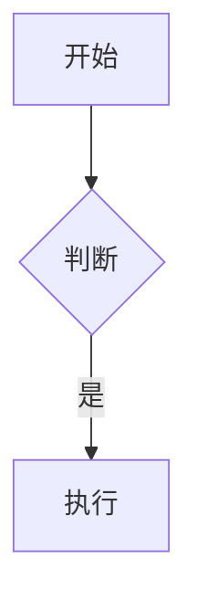

# vitepress-doc-site

将 Markdown 文件搭建为 VitePress 文档网站。

## 触发条件

- 用户说 "把这个项目的 markdown 文档搭成网页"
- 用户说 "帮我建个 VitePress 文档站"
- 用户说 "把 docs 目录用 web 方式展示"

## 功能

1. 检测 Node.js 环境，添加 vitepress、vitepress-plugin-mermaid、mermaid 到 devDependencies
2. 自动扫描已用端口（从 5173 起，间隔 10），分配空闲端口
3. 创建 `docs/package.json`（dev/build/preview，使用 `../node_modules/.bin/vitepress`，固定端口，含 `type: module`）
4. 创建 `docs/.vitepress/config.ts`（导航、侧边栏），使用 `withMermaid()` 包装 + 中文搜索（Intl.Segmenter 词级分词）+ optimizeDeps.include（fastdom 等，防 dev 白屏）
5. 创建首页 `docs/index.md`（home layout）
6. 侧边栏两种模式：自动侧栏（复制 `auto-sidebar.mjs`，文件夹结构即菜单，新文件天然有入口）或手写（需分组语义时）
7. 主题五件套（index.ts / layout.css / tables.css / enhance-tables.ts / enhance-layout.ts）：内置布局皮肤（三栏解锁 + 侧栏钉宽 + 顶栏跟随 + 面板显隐开关）+ 表格增强

## 输出结构

```
project/
├── package.json          # vitepress 在 devDependencies
├── docs/
│   ├── package.json       # docs 专属脚本
│   ├── index.md           # 首页
│   ├── .vitepress/
│   │   ├── config.ts      # 站点配置
│   │   └── theme/
│   │       └── index.ts   # 主题扩展
│   └── guide/             # 文档内容
```

## 启动

```bash
cd docs && npm run dev
```

## 示例

### 导航栏
```typescript
nav: [
  { text: '首页', link: '/' },
  { text: '指南', link: '/guide/' },
]
```

### 侧边栏（折叠组）
```typescript
sidebar: {
  '/guide/': [
    {
      text: '分组名',
      collapsed: false,
      items: [
        { text: '页面一', link: '/guide/page1' },
      ]
    },
  ],
}
```

### Mermaid 支持

内置：`vitepress-plugin-mermaid` + `withMermaid()` 包装 config。

````markdown

````

### 中文搜索

内置：config 的 `themeConfig.search` 用 Intl.Segmenter 词级分词透传给 MiniSearch，中文长句可正常命中（默认 regex 分词对中文基本搜不到）。

### 自动侧栏

可选：复制源仓库 `docs/.vitepress/auto-sidebar.mjs`（零依赖，约 120 行）到新站，config 中：

```typescript
import { autoSidebar } from './auto-sidebar.mjs'

sidebar: {
  '/guide/': autoSidebar({
    rootDir: new URL('../guide', import.meta.url).pathname,  // 相对 .vitepress/ 目录
    routePrefix: '/guide/',
  }),
}
```

文件夹结构即菜单：新 .md 文件自动出现入口，标题自动提取（frontmatter title > H1 > 文件名），子目录成折叠组。需分组语义时仍用手写侧边栏。
